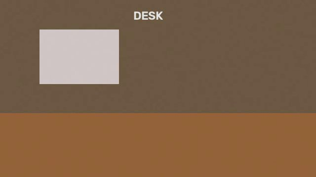
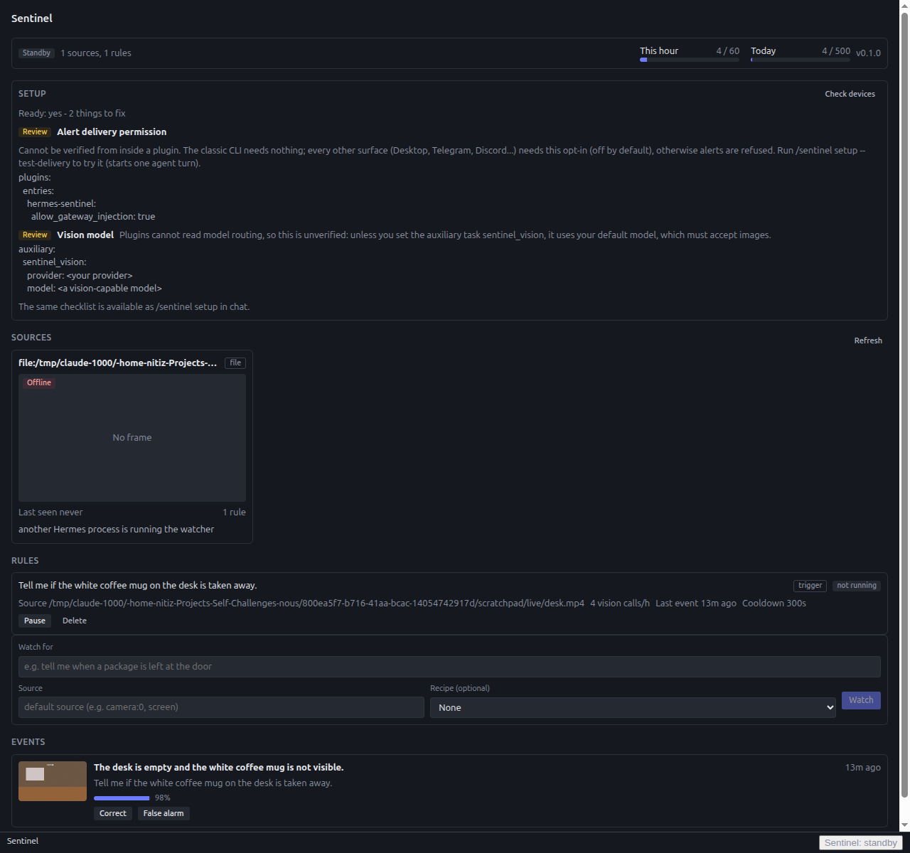
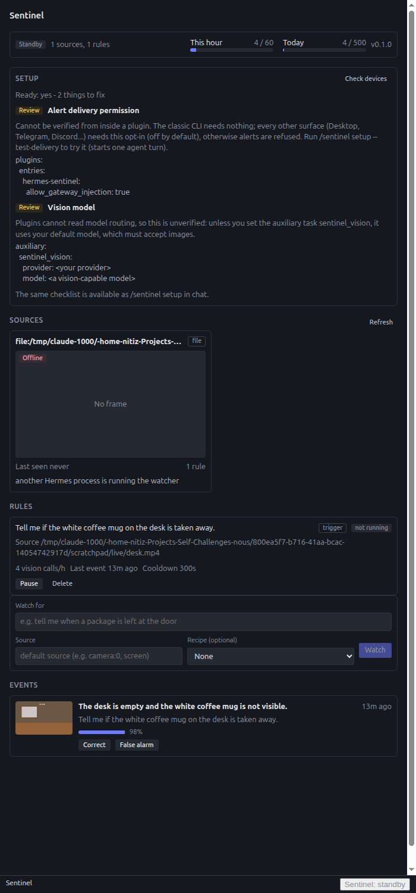

# Live test

A real run of the plugin inside Hermes, with a real vision model, on 2026-11-07. This page records what was tested, how to repeat it, what happened and what is still untested.

## What was tested

| Item | Value |
|---|---|
| Hermes | v0.23.0, in an isolated `HERMES_HOME` (not a real user home) |
| Provider and model | Nous Research, `openai/gpt-6-luna-pro` (accepts images) |
| Surface | classic terminal (`hermes --cli`) |
| Source | `file:` video source, non-looping |
| Install | `scripts/dev_install.sh --home <isolated home> --apply`, then `plugins.entries.hermes-sentinel.allow_gateway_injection: true` |

The test covers the whole path: setup check, a plain-English request, tool discovery by the agent, rule compiling, the change gate, one vision judgement, event storage with a snapshot, alert injection into the chat and the agent's reply.

## Reproduce

1. Create an empty directory to use as the Hermes home. Do not use `~/.hermes`.
2. Link the plugin into it: `scripts/dev_install.sh --home <isolated home> --apply`.
3. In `<isolated home>/config.yaml` set:
   ```yaml
   plugins:
     entries:
       hermes-sentinel:
         allow_gateway_injection: true
   ```
4. Configure a provider and a model that accepts images. Sentinel uses the default model unless the `sentinel_vision` auxiliary task is routed elsewhere.
5. Generate the test video (script below).
6. Start Hermes with `HERMES_HOME=<isolated home>` in any terminal or tmux. The first run in a fresh home shows a telemetry opt-in prompt; the default answer is "No thanks".
7. Run `/sentinel setup`, then type the prompt below.

## Generating the test video

15 s, 640x360, 10 fps: a static desk with a mug, the mug removed after 8 s, light sensor noise. Only numpy and cv2 are needed.

```python
import cv2
import numpy as np

WIDTH, HEIGHT, FPS, SECONDS, REMOVED_AT = 640, 360, 10, 15, 8
rng = np.random.default_rng(0)


def desk_frame(with_mug: bool) -> np.ndarray:
    frame = np.full((HEIGHT, WIDTH, 3), (60, 90, 120), np.uint8)
    cv2.rectangle(frame, (0, 220), (WIDTH, HEIGHT), (40, 70, 100), -1)
    if with_mug:
        cv2.rectangle(frame, (280, 150), (360, 240), (245, 245, 245), -1)
        cv2.ellipse(frame, (370, 195), (22, 28), 0, -90, 90, (245, 245, 245), 6)
    return frame


writer = cv2.VideoWriter("desk.mp4", cv2.VideoWriter_fourcc(*"mp4v"), FPS, (WIDTH, HEIGHT))
for index in range(FPS * SECONDS):
    frame = desk_frame(with_mug=index / FPS < REMOVED_AT).astype(np.int16)
    frame += rng.integers(-3, 4, frame.shape, dtype=np.int16)
    writer.write(np.clip(frame, 0, 255).astype(np.uint8))
writer.release()
```

The video is not committed.

## Setup output

`/sentinel setup` in the live session:

```
Python packages            ok
Alert delivery permission  warn  cannot be verified from inside a plugin; fix YAML shown
Vision model               warn  unverified; uses the default model, which must accept images
Cameras and screens        ok    found screen:0, screen:1, camera:0
Default source             ok
Watcher                    not started yet
Storage                    writable
Alert destination          known
Budget caps                60/hour, 500/day
Rules                      none
Ready: yes - 2 items to review
```

The two warnings are the expected ones: neither the permission nor the model's image support can be checked ahead of time.

## Transcript (shortened)

Prompt typed to the agent:

```
Use the sentinel tools to watch the video file <scratchpad>/desk.mp4 and tell me
if the white coffee mug on the desk is taken away
```

- The agent found the Sentinel tools itself through tool search.
- It called `sentinel_sources`, then `sentinel_watch` (5.4 s).
- Rule `r24892c38` was created: mode `trigger`, question "Is the white coffee mug missing from the desk?", cooldown 300 s, compiled by the LLM.
- The agent told the user that alerts are injected into the chat.

When the mug left the scene:

- The gate flagged the change.
- One judge call through the `sentinel_vision` auxiliary task (`plugin_llm.complete_structured`, content type json, about 3660 tokens) returned `match`, confidence 0.98, caption "The desk is empty and the white coffee mug is not visible."
- Event #1 was stored with its snapshot.
- A `[Sentinel alert]` message was injected (Hermes log: `Plugin message injection admitted`).
- The agent turn replied: "Sentinel detected that the desk is empty and the white mug is gone (98% confidence, ...)" with the snapshot path.
- When the video ended, Sentinel sent one `[Sentinel notice]` ("source finished") and stopped.
- `/sentinel list` showed `r24892c38 [firing] ... last event #1`.

The frame saved with the event:



## Result

| Check | Result |
|---|---|
| Agent discovered and called the tools from plain English | yes |
| Rule compiled and created | yes (`r24892c38`) |
| Gate flagged the change | yes |
| Judge calls for the event | 1 (match, confidence 0.98) |
| Vision calls for the whole run (usage table) | 4, including the start-up look |
| Event stored with snapshot | yes (#1) |
| Alert injected, agent replied with snapshot path | yes |
| End of video handled | one notice, watcher stopped |
| Rule state | `[firing]`, last event #1 |

## Desktop pane preview (stub host)

The real Desktop app was not run (it is an Electron app that needs a built desktop bundle and a display session), so none of this is real-Desktop verification. Instead `desktop/plugin.js` was bundled with real React 19 against a stand-in for `@hermes/plugin-sdk` and rendered in headless Chrome, with its REST calls proxied to the live isolated Hermes backend from this test. The stub host supplies plain CSS for `Badge`, `Button` and `CopyButton` and a few theme variables, so colours and spacing of those parts differ from the real app. The engine was not running, so the source tile shows its offline state (the frame request returns 404, which is the one console error).

Preview harness: `tests_tools/pane_preview/` (`node serve.mjs --token-file <path>`, then open http://127.0.0.1:8765/).

Wide (1280 px):



Narrow (700 px):



Bugs this found and fixed: React key warnings (keys were passed inside spread props), the source grid never applied because a later CSS rule overrode it (one tile stretched to full width), long source paths overflowing the tile title, setup rows without spacing, and a green "not running" badge on a rule that was not watching.

## Quality gate on the same commit

`scripts/check.sh --with-hermes` passes: `hermes plugins validate` reports the security scan as safe, `hermes plugins doctor` is ok, with 1430 plugin tests and 195 tool tests. An earlier validate run caught the install scanner flagging a phrase in the README; that is fixed.

## Observations and limitations

- The classic `hermes --cli` terminal did not render the injected alert turn live. The turn is in the session history and `state.db`; Hermes logged "response ready" and a "native image send unavailable" fallback for the local platform, so in the CLI the photo goes out as a path. The alert displays on surfaces that render gateway turns and native images (Desktop, Telegram, Discord). For a demo, use Desktop or Telegram rather than the classic CLI.
- The first run in a fresh Hermes home shows a telemetry opt-in prompt. The default is "No thanks".

## Not yet tested

- Hermes Desktop: the Sentinel pane and live rendering of the injected alert.
- Telegram (and other messaging platforms): alert with a photo.
- A real webcam.
- Tuning on real-world footage (lighting changes, people, pets, longer sessions).
